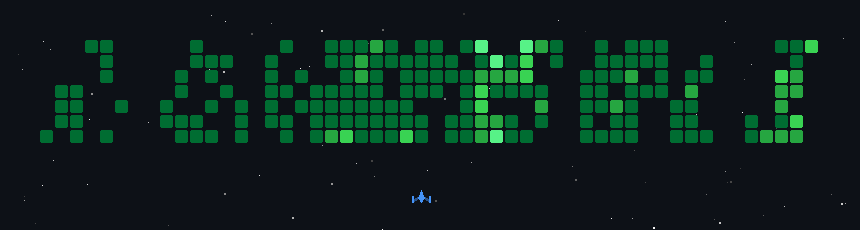

### Business problems. Reliable backends. Products that ship.

8+ years designing APIs, databases, and backend systems, with end-to-end product ownership. 
I use AI throughout engineering. Architecture, trade-offs, and every merge stay my responsibility.

**[Explore my work](#selected-work)** &nbsp; / &nbsp; **[How I engineer](#how-i-engineer)** &nbsp; / &nbsp; **[My stack](#tools-of-the-trade)**

---

## Selected work

### 01 / [Laravel HTTP Beacon ↗](https://github.com/tintaungkhant/laravel-http-beacon)

 &nbsp; `PHP` `Laravel` `Observability`

> **Find the request. Understand what happened.**

Search incoming and outgoing HTTP traffic, then follow the related queries, model changes, and jobs. Built from debugging real production systems.

Request tracing &nbsp; / &nbsp; Searchable traffic &nbsp; / &nbsp; Production debugging

---

### 02 / [tasky ↗](https://github.com/tintaungkhant/tasky)

 &nbsp; `Go` `Git` `Developer tooling`

> **One ticket. Multiple repos. One workspace.**

Keep a task's Git worktrees together across repositories. Consistent branch names, ready-to-open editor workspaces, and cleanup when the work is done.

Task workspaces &nbsp; / &nbsp; Branch conventions &nbsp; / &nbsp; Less context switching

---

### 03 / Zay Thal Gyi Copilot

  &nbsp; `TypeScript` `AI agents`

> **Business actions, beyond the chat box.**

An AI assistant built around business workflows, tool calling, and code-enforced rules. Evaluated against real cases; currently in playground testing, not customer-live.

Tool calling &nbsp; / &nbsp; Evaluations &nbsp; / &nbsp; Business rules

---

### 04 / Zay Thal Gyi POS

  &nbsp; `Retail` `Inventory` `Payments`

> **Burmese-first software for everyday retail.**

Sales, inventory, purchasing, cash shifts, and local payments across stores. Core web app built; release polish and additional capabilities remain.

Myanmar language &nbsp; / &nbsp; Multi-store workflows &nbsp; / &nbsp; Local payments

## How I engineer

- **Start with the business.** Clarify the workflow and constraints before choosing the architecture.
- **Keep complexity on a budget.** Prefer a monolith until service boundaries earn their place.
- **Make AI prove useful.** Test against real cases, inspect failures, and review the code before merging.
- **Put guarantees in code.** Models interpret intent; software enforces money, permissions, and state transitions.

<b>The experience that shaped this</b>

At 19, about a year into programming, I inherited a Japanese influencer platform after its senior developer left. I rebuilt its backend, database, APIs, and web application, learning Vue 2 and handling Stripe and GMO payment integrations along the way. Others handled the mobile apps.

That shaped how I work today: take responsibility, ask questions, and keep learning until the system works.

## Tools of the trade

<picture>
  <source media="(prefers-color-scheme: dark)" srcset="assets/reused/stack-dark.svg" />
  <source media="(prefers-color-scheme: light)" srcset="assets/reused/stack-light.svg" />
  
</picture>

Also working with Fastify, Python, Next.js, Nuxt.js, and NestJS. Tools change. Understanding the problem stays.

## Contributions in motion

My contribution calendar, arcade mode. More contributions make tougher enemies. Refreshed daily · <a href="https://github.com/tintaungkhant?tab=overview">Explore the activity</a>

---

**Open to senior engineering roles, consulting, and startup partnerships.**

[Explore my repositories ↗](https://github.com/tintaungkhant?tab=repositories)

No unnecessary code. No unnecessary complexity. Just systems that work.

[Built with great open-source README tools](PROFILE-CREDITS.md)

