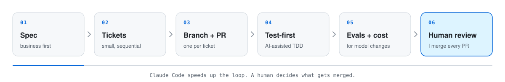
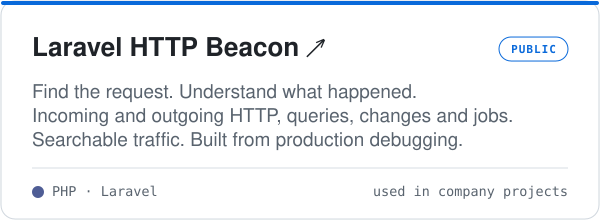
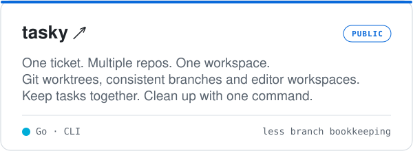
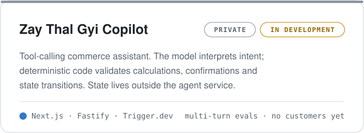
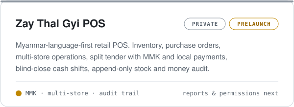

  
  
  
  

  I design backend systems, build AI-powered products, and turn business problems into software that ships. 
  AI helps me move faster. Engineering judgment decides what stays.

<h3 align="center">No unnecessary code. No unnecessary complexity. Just systems that work.</h3>

 

## How I work

<table>
  <tr>
    <td width="50%" valign="top">
      <code>01</code> &nbsp;<b>Business first</b> 
      I ask questions and agree on the solution with stakeholders before I write code.
    </td>
    <td width="50%" valign="top">
      <code>02</code> &nbsp;<b>Simplicity over abstraction</b> 
      YAGNI, until real evidence says otherwise. No layers just to look senior.
    </td>
  </tr>
  <tr>
    <td width="50%" valign="top">
      <code>03</code> &nbsp;<b>Code enforces invariants</b> 
      LLMs interpret intent. Business rules never live in a prompt.
    </td>
    <td width="50%" valign="top">
      <code>04</code> &nbsp;<b>Measure, then decide</b> 
      If an approach fails real use cases, I replace it.
    </td>
  </tr>
</table>

## AI-first, human-reviewed

> [!TIP]
> **One example:** I replayed failed chats against a multi-stage router/specialist/composer pipeline and a single tool-calling agent. The single agent did better, so I dropped the pipeline.

## Stack

<picture>
  <source media="(prefers-color-scheme: dark)" srcset="https://skillicons.dev/icons?i=php,laravel,ts,nodejs,postgres,mysql,redis&theme=dark">
  
</picture>

<b>CORE</b> &nbsp;·&nbsp; plus LLM agents, tool calling and evals

<b>ALSO</b> &nbsp;·&nbsp; used in production work, not all at the same depth

## Selected work

<table>
  <tr>
    <td width="50%">
      
    </td>
    <td width="50%">
      
    </td>
  </tr>
  <tr>
    <td width="50%">
      
    </td>
    <td width="50%">
      
    </td>
  </tr>
</table>

The public repos are linked. The two Zay Thal Gyi projects are private and haven't launched yet.

## Activity

<picture>
  <source media="(prefers-color-scheme: dark)" srcset="profile-3d-contrib/profile-night-view.svg">
  
</picture>

<table>
  <tr>
    <td width="50%">
      <picture>
        <source media="(prefers-color-scheme: dark)" srcset="profile-summary-card-output/github_dark/2-most-commit-language.svg">
        
      </picture>
    </td>
    <td width="50%">
      <picture>
        <source media="(prefers-color-scheme: dark)" srcset="profile-summary-card-output/github_dark/1-repos-per-language.svg">
        
      </picture>
    </td>
  </tr>
</table>

Generated daily by GitHub Actions and stored in this repo. Private and company work may not show up here.

## Along the way

At 19, about a year into programming, I inherited a Japanese influencer platform when its senior developer left and the promised replacement never arrived. I rebuilt the backend, database, APIs and web app (the mobile apps were handled by others). I learned Vue 2 on the job and got Stripe and Japanese GMO payments working despite the language barrier.

Since then I've owned company products end to end, from engineering and design to customer support. The domains have included:

`crypto payments` &nbsp;`car auctions` &nbsp;`fleet tracking` &nbsp;`school meal systems` &nbsp;`CRM & chat integrations` &nbsp;`scheduling & media workflows`

Outside work: games, learning, and mathematics.

## Let's talk

I'm open to employment, consulting and startup partnerships.

  

